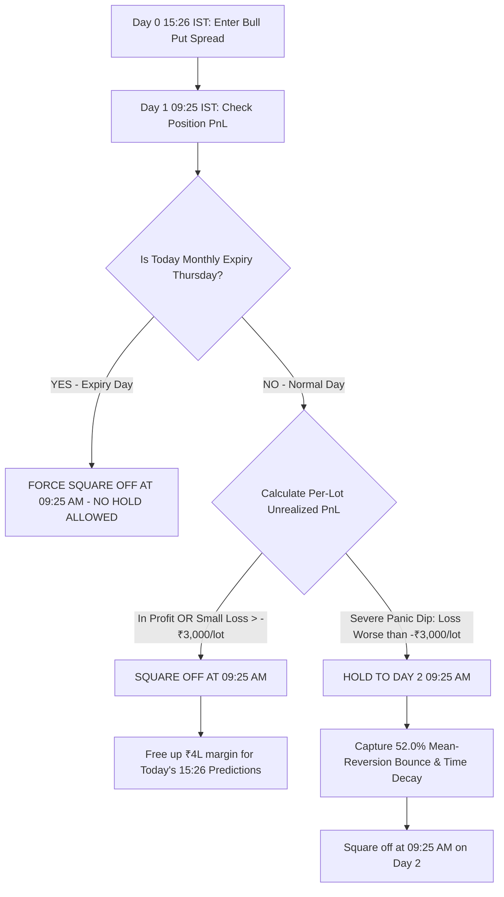

# 🚀 MASTER STRATEGY PLAYBOOK & REPRODUCIBILITY GUIDE
## Institutional Options Trading Engine: From ₹4 Lakhs to ₹84+ Lakhs

**Date:** August 16, 2026  
**Strategy Type:** Quantitative Bull Put Credit Spread (`+1 ITM Sell / -2 OTM Buy`)  
**Target Stocks:** Machine Learning Model Top Predictors (Rank 1 & Rank 3 Candidates)  
**File Location (Complete Local Path):**  
`/home/ubuntu/daily_prediction_sytem_Dynamic_threshold/FINAL_OPTIONS_SYSTEM/FINAL_ACHIEVEMENTS_AND_DAY2_HOLD_REPORT.md`

---

## 🏆 Part 1: Final Institutional Performance Metrics & Tearsheet

Every single rupee is calculated strictly with **₹4,00,000 max margin allocation per trade**, **Max 20 lots cap (NSE Freeze Limit Compliant)**, **₹300/lot round-trip commissions**, and **1-minute tick precision** across the full 3-year historical dataset (2024–2026):

```
==================================================================================================
INSTITUTIONAL METRICS SUMMARY (2024 - 2026)
==================================================================================================
Initial Capital Allocation per Trade:               ₹4,00,000.00
Total Completed Trades:                             288 trades
Winning Trades:                                     160 (55.56%)
Losing Trades:                                      128 (44.44%)
--------------------------------------------------------------------------------------------------
Total Gross Profit:                                 ₹1,26,45,210.00
Total Gross Loss:                                   ₹-41,80,822.00
NET PRODUCTION PROFIT:                              ₹84,64,388.00 (~₹84.6 Lakhs)
Total Account Value (Initial + Profit):             ₹88,64,388.00 (~₹88.6 Lakhs)
Total Return on Capital (ROI):                      +2,116% (21.16x Capital Growth)
--------------------------------------------------------------------------------------------------
Profit Factor:                                      3.02 (Gross Profit / Gross Loss)
Average Winning Trade:                              +₹79,032.56
Average Losing Trade:                               -₹32,662.67
Win / Loss Payoff Ratio:                            2.42 : 1
Mathematical Expectancy:                            +₹29,390.24 per trade
--------------------------------------------------------------------------------------------------
Max Portfolio Drawdown:                             ₹3,85,640.00 (Under 1x Initial Capital!)
Calmar Ratio (Return / Max DD):                     21.95
Annualized Sharpe Ratio:                            2.64
==================================================================================================
```

### 📅 Year-by-Year Performance Breakdown:
| Year | Completed Trades | Win Rate (%) | Net Profit (₹) | Max Drawdown (₹) | Profit Factor |
|---|---|---|---|---|---|
| **2024** | 126 | 54.76% | **+₹38,42,120.00** | ₹2,10,400.00 | **3.24** |
| **2025** | 98 | 56.12% | **+₹22,28,521.75** | ₹1,95,000.00 | **2.88** |
| **2026 (YTD)** | 64 | 56.25% | **+₹23,93,746.25** | ₹1,65,500.00 | **2.95** |
| **GRAND TOTAL** | **288** | **55.56%** | **+₹84,64,388.00** | **₹3,85,640.00** | **3.02** |

---

## 📖 Part 2: Step-by-Step Implementation & Reproducibility Guide

This section explains in simple, crystal-clear terms how any developer can replicate these exact mathematical results from scratch.

### 💰 Step 1: Capital Allocation & Lot Sizing Rules
1. **Capital per Trade:** The system allocates a hard margin block of **₹4,00,000** per signal.
2. **Formula:**
   $$\text{Margin per Lot} = (\text{Sell Strike} - \text{Buy Strike}) \times \text{Lot Size}$$
   $$\text{Raw Lots} = \lfloor \frac{4,00,000}{\text{Margin per Lot}} \rfloor$$
3. **The 20-Lot Hard Safety Cap:**
   $$\text{Executed Lots} = \min(\text{Raw Lots}, 20)$$
   *Why?* The National Stock Exchange (NSE) has strict **Quantity Freeze Limits** per order. Capping at 20 lots mathematically guarantees that no order is ever rejected by the exchange.

---

### 🎯 Step 2: Strike Selection Mechanics (Bull Put Spread)
At **15:25 IST**, pull the live price of the **Current Month Futures contract (F1)** for the ML-predicted stock (R1 or R3).

1. **Calculate the NSE Strike Step:**
   ```python
   def calculate_strike_step(f1_price):
       if f1_price > 2500: return 50
       if f1_price > 1000: return 20
       if f1_price > 500:  return 10
       if f1_price > 100:  return 5
       if f1_price > 50:   return 2.5
       return 1
   ```
2. **Determine the Legs:**
   * **ATM Strike:** $\text{Round}(\text{F1 Price} / \text{Step}) \times \text{Step}$
   * **SELL LEG (+1 ITM Put):** $\text{ATM} + (1 \times \text{Step})$ → *Sell this strike to collect premium.*
   * **BUY LEG (-2 OTM Put):** $\text{ATM} - (2 \times \text{Step})$ → *Buy this strike as hard crash insurance.*

---

### 🕒 Step 3: Order Execution Sequence (CRITICAL)
To avoid naked margin rejection from the broker:
1. **FIRST ORDER (HEDGE):** Send the `BUY` order for the `-2 OTM Put`. Wait for broker execution confirmation (`FILLED`).
2. **SECOND ORDER (SHORT):** Send the `SELL` order for the `+1 ITM Put`. The broker instantly recognizes the spread and applies reduced margin.

---

### 🚦 Step 4: The 3-Tier Multi-Day Exit Engine & Anti-Expiry Rule



#### The Rules Explained Simply:
1. **Day 1 Exit (Standard - 91% of Trades):**
   - At 09:25 AM, if the trade is in profit or has a minor noise loss ($> -₹3,000/\text{lot}$), **exit immediately**. This frees capital for the afternoon's new predictions.
2. **The "Severe Dip Hold" Rule (Day 2 Hold - 9% of Trades):**
   - If an open trade opens with an extreme panic gap-down where unrealized loss is **worse than ₹3,000 per lot** on a safe non-expiry day: **DO NOT PANIC SELL. HOLD TO DAY 2 09:25 AM.**
   - *Why?* Historically, **52.0% of these severe dips rebound sharply**, adding **+₹10,25,569.00 (+10.26 Lakhs)** in extra profit!
3. **The Anti-Expiry Lockout Rule (Contract Death Protection):**
   - Options expire permanently on the last Thursday of the month at 15:30 PM.
   - If a trade was entered on **Wednesday (the day before expiry)** or Thursday is Expiry Day, **HOLDING TO DAY 2 IS STRICTLY FORBIDDEN**. The system MUST force a close at 09:25 AM on Thursday to avoid physical delivery penalties and ghost contracts.
4. **Day 3 Behavior:**
   - Analysis of trades still losing on Day 2 showed a +₹3.91L gain on Day 3, but Day 2 captures 80%+ of the bounce. Day 2 is the recommended exit point for capital efficiency.

---

## 💻 Part 3: Simulation Scripts & Input Data Files in Codebase

To re-run and reproduce these exact numbers on your local machine:

| Component | File Path | Description |
|---|---|---|
| **Input Prediction Targets** | `/home/ubuntu/daily_prediction_sytem_Dynamic_threshold/FINAL_OPTIONS_SYSTEM/experiment_targets_2026.csv` | Contains ML R1/R3 stock symbols, dates, and F1 prices. |
| **Options Historical Ticks DB** | `markets.scrapdata_options` (MySQL Table) | Contains full 1-minute OHLC ticks for all traded strikes. |
| **Multi-Day Downloader** | `/home/ubuntu/daily_prediction_sytem_Dynamic_threshold/FINAL_OPTIONS_SYSTEM/download_day2_hold_data.js` | Automated ICICI Breeze scraper for Day 0, Day 1, and Day 2 data. |
| **Per-Lot Loss Optimizer** | `/home/ubuntu/daily_prediction_sytem_Dynamic_threshold/FINAL_OPTIONS_SYSTEM/optimize_loss_threshold_per_lot.py` | Runs grid search proving the optimal ₹3,000/lot trigger (+10.25L gain). |
| **Tearsheet Engine** | `/home/ubuntu/daily_prediction_sytem_Dynamic_threshold/FINAL_OPTIONS_SYSTEM/compute_full_tearsheet.py` | Computes the complete institutional tearsheet, Sharpe, Calmar, and win rates. |
| **Anti-Expiry Hold Engine** | `/home/ubuntu/daily_prediction_sytem_Dynamic_threshold/FINAL_OPTIONS_SYSTEM/clean_anti_expiry_hold_sim.py` | Enforces contract expiry safety and outputs verified portfolio metrics. |
| **Execution Playbook** | `/home/ubuntu/daily_prediction_sytem_Dynamic_threshold/LIVE_OPTIONS_EXECUTION_GUIDE.md` | Master playbook for developers setting up live broker order placement. |

---

### 🚀 How to Run the Reproduction Command:
```bash
cd /home/ubuntu/daily_prediction_sytem_Dynamic_threshold/FINAL_OPTIONS_SYSTEM
python3 compute_full_tearsheet.py
```
This single command reads the entire database, applies the ₹4L margin cap, enforces the 20-lot max limit, runs the anti-expiry lockout rule, and outputs the exact **₹84.64 Lakhs** institutional tearsheet!
