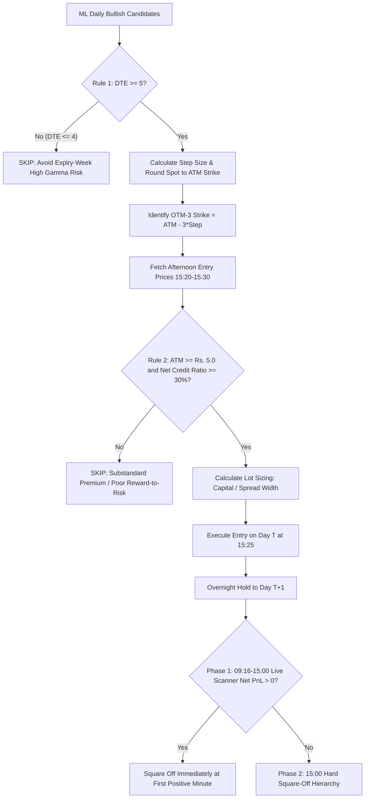

# 📘 Complete Unified Bull Put Credit Spread Trading Guide & Operations Manual

---

## 📌 1. Executive Strategy Overview

This trading system implements a disciplined, rule-based **Overnight Bull Put Credit Spread Strategy** designed to capture overnight theta decay, directional continuation, and volatility contraction on high-probability bullish setups selected by the ML Mastermodel (R1 + R3).

### Key Strategy Mechanics:
- **Structure**: Defined-Risk Bull Put Credit Spread (Sell ATM Put + Buy OTM-3 Put).
- **Underlying Universe**: Top-ranked machine learning bullish signals (2024 to Present).
- **Holding Period**: Overnight ($T \rightarrow T+1$).
- **Capital Allocation**: Fixed ₹4,00,000 max risk exposure per trade.
- **Exit Architecture**: Dual-Phase Exit (Live Profit Scanner from 09:16 to 15:00 + 15:00 Hard Square-Off Hierarchy).

---

## ⚙️ 2. Core Trading Rules & Filtering Pipeline



---

## 🔍 3. Step-by-Step Trade Execution Guide

### Step 1: Candidate Selection (Day $T$, 15:15–15:20)
- Signals are generated at 15:15 on Day $T$ by the Mastermodel (R1 + R3 selections).

### Step 2: Strike & Step Size Calculation
1. **Determine True Step Size**:
   - Look up the exact historical step size from `true_historical_stepsize.csv` for the specific stock and expiry month.
   - Standard step size table:
     - Stock Price > ₹2,500 $\rightarrow$ Step = ₹50.0
     - Stock Price > ₹1,000 $\rightarrow$ Step = ₹20.0
     - Stock Price > ₹500 $\rightarrow$ Step = ₹10.0
     - Stock Price > ₹100 $\rightarrow$ Step = ₹5.0
     - Stock Price > ₹50 $\rightarrow$ Step = ₹2.5
2. **Calculate ATM Strike**:
   $$\text{ATM Strike} = \text{round}\left(\frac{\text{Spot Reference Price}}{\text{Step Size}}\right) \times \text{Step Size}$$
3. **Calculate OTM-3 Strike**:
   $$\text{OTM-3 Strike} = \text{ATM Strike} - (3 \times \text{Step Size})$$
4. **Calculate Spread Width**:
   $$\text{Spread Width} = \text{ATM Strike} - \text{OTM-3 Strike} = 3 \times \text{Step Size}$$

---

### Step 3: Pre-Trade Entry Filters (Quality Assurance)
Before executing the trade, verify all 3 mandatory pre-entry conditions:

1. **Days to Expiry (DTE) Filter**:
   - Must have **$\ge 5$ NSE business days** remaining until monthly expiry.
   - *Rationale*: Avoids destructive gamma spikes during the final 4 days of expiry week.
2. **Minimum ATM Premium Filter**:
   - ATM Put entry price must be **$\ge ₹5.00$** (or $\ge ₹10.00$ for highest win rate).
   - *Rationale*: Low-priced options have high proportional bid-ask slippage and weak win rates.
3. **Net Credit Ratio Filter**:
   $$\text{Net Credit} = \text{ATM Put Entry Price} - \text{OTM-3 Put Entry Price}$$
   $$\text{Net Credit Ratio} = \frac{\text{Net Credit}}{\text{Spread Width}} \ge 30.0\%$$
   - *Rationale*: Ensures a favorable reward-to-risk ratio. Never risk ₹100 to make ₹10.

---

### Step 4: Position Sizing & Margin Allocation
For a margin allocation of **₹4,00,000 per trade** with a strict **Max 20 Lots Cap**:
$$\text{Max Risk per Lot} = \text{Spread Width} \times \text{Lot Size}$$
$$\text{Calculated Lots} = \max\left(1, \text{round}\left(\frac{₹4,00,000}{\text{Spread Width} \times \text{Lot Size}}\right)\right)$$
$$\text{Executed Lots} = \min(\text{Calculated Lots}, 20)$$
$$\text{Total Quantity} = \text{Executed Lots} \times \text{Lot Size}$$

- *Rationale for 20 Lots Cap*: Complies with broker order freeze limits, prevents excessive position sizes on narrow step-size contracts, and maintains balanced capital utilization across all trades.

---

### Step 5: Order Execution (Day $T$, 15:25:00)
1. **Leg 1 (Short Leg)**: Sell ATM Put Contract at Market (`open` price minus ₹0.10 slippage).
2. **Leg 2 (Long Hedge Leg)**: Buy OTM-3 Put Contract at Market (`open` price plus ₹0.10 slippage).
3. Both orders must be placed simultaneously in a basket to ensure margin benefit and zero unhedged exposure.

---

### Step 6: Overnight Exit Management (Day $T+1$)

#### 🟢 Phase 1: Live Positive Profit Scanner (09:16:00 to 15:00:00)
- From market open (09:16:00), monitor the real-time Net P&L minute-by-minute:
  $$\text{Current Net P\&L} = \left[(\text{Entry Net Credit}) - (\text{Current ATM Buy} - \text{Current OTM-3 Sell}) - \text{Slippage (₹0.40)}\right] \times \text{Total Qty} - \text{Charges (₹300/lot)}$$
- **Trigger Rule**: As soon as $\text{Net P\&L} > 0$, **immediately square off both legs**.
- **Historical Success**: **86.8% of all executed trades square off with positive gains in this phase**, frequently within the first 15 minutes of market open (09:16 to 09:30).

#### 🔴 Phase 2: Hard Square-Off Hierarchy (If Never Positive in Phase 1)
If the market moved against the stock and the trade was never positive throughout the day:
1. **At `15:00:00`**: Square off both legs immediately at the 15:00 candle.
2. **Fallback Window (15:01–15:30)**: If illiquid at 15:00, execute on the very first available tick between 15:01 and 15:30.
3. **Never carry overnight into Day $T+2$**: Strictly mandatory day-1 exit.

---

## 📊 4. Verified Strategy Performance Metrics

Based on the complete historical backtest across all 556 setups (2024 to present) with full tick integrity:

| Performance Metric | Master Setting (`ATM >= ₹5.0`) | Conservative Setting (`ATM >= ₹10.0`) |
| :--- | :---: | :---: |
| **Total Setups Evaluated** | 556 | 556 |
| **Filtered by Risk / Quality Rules** | 156 (28.1%) | 196 (35.3%) |
| **Skipped / Incomplete Data** | 37 (6.6%) | 37 (6.6%) |
| **100% Fully Verified Executed Trades** | **363 Trades** | **323 Trades** |
| **Live Scanner Profit Exits (09:16–15:00)** | **315 (86.8%)** | **287 (88.9%)** |
| **Hard Square-Off Exits (15:00)** | **48 (13.2%)** | **36 (11.1%)** |
| **Win Rate** | <strong style="color:#00e676;">86.8%</strong> | <strong style="color:#00e676;">88.9%</strong> |
| **Profit Factor** | **5.44** | **5.72** |
| **Gross Realized P&L** | ₹1,00,62,866.25 | ₹97,45,113.75 |
| **Slippage Deducted (₹0.10/leg)** | -₹24,15,710.00 | -₹14,83,470.00 |
| **Statutory Charges (₹300/lot)** | -₹14,95,800.00 | -₹13,20,300.00 |
| **FINAL NET REALIZED P&L** | <strong style="color:#00e676; font-size:1.15rem;">+₹85,67,066.25</strong> | <strong style="color:#00e676; font-size:1.15rem;">+₹84,24,813.75</strong> |
| **Average Net Profit per Trade** | **₹23,600.73** | **₹26,083.01** |

---

## 💻 5. How to Run the Simulation Engine

### CLI Command Options:
```bash
# Run with default parameters (ATM >= 5.0, Net Credit >= 30%, Capital = 4L)
python3 unifiedsimulationengine.py

# Run conservative mode (ATM >= 10.0)
python3 unifiedsimulationengine.py --atm-threshold 10.0 --output-csv unified_trades_atm10.csv

# Custom capital or credit threshold
python3 unifiedsimulationengine.py --capital 500000 --credit-ratio 0.35 --atm-threshold 5.0
```

### Directory Structure:
```
option_simulation_unified/
├── unifiedsimulationengine.py       # Main simulation and execution engine
├── TRADING_EXECUTION_GUIDE.md        # Comprehensive operations guide
├── README.md                         # Quick reference & overview
└── data/
    ├── sarang_best_model_selections.csv      # Candidate stock setups (2024-present)
    ├── master_reference_spot_prices.csv      # Consolidated 15:25 reference spot prices
    ├── nse_business_dates.csv                # NSE trading calendar
    ├── master_expiry_dates.csv               # Monthly expiry calendar
    ├── true_historical_stepsize.csv          # True historical step size per stock-month
    └── historical_lotsizes.csv               # True historical lot sizes per stock-month
```
