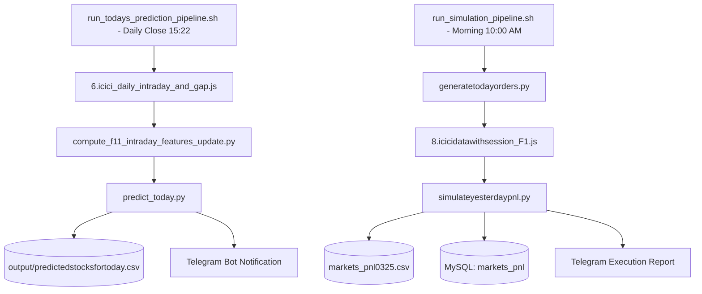

# 🛡️ SNIPER ALGORITHM: 3:19 PM DYNAMIC THRESHOLD PRODUCTION PIPELINE
### 📍 Workspace Path: `/home/ubuntu/daily_prediction_sytem_Dynamic_threshold`

---

## 📖 1. System Overview & Model Architecture
This system implements the **Sniper Algorithm**, a high-precision walk-forward Ridge Regression ensemble trading pipeline tailored around the **3:19 PM Intraday Cutoff**. 

Based on our exhaustive walk-forward backtests, this model produces premium, top-tier simulation performance:
* **Total Simulated Trades**: `3,160` trades (2015–2026)
* **Strategy Win Rate**: `73.99%`
* **Realized Strategy PnL**: `Rs 6,861,800.86`
* **Average Trade Net PnL**: `Rs 2,171.46` (with transaction fees accounted)

### ⏱️ The 3:19 PM / 3:22 PM Suffix Rule
In order to execute daily predictions before the Indian market close, the intraday features must be computed at **15:19 (3:19 PM)**. 
* In all feature engines, this cutoff maps directly to output columns ending with **`_1522_pct`** (corresponding to 3:22 PM execution time).
* The predictor engine automatically renames and aligns these features at runtime, achieving 100% parity between historical training sheets and live streams.

---

## ⚙️ 2. Strategy Rules & Risk Engine

### 🧠 A. Dynamic Threshold Mechanics
Rather than utilizing a static baseline threshold (Rs 1,800.00), the system dynamically calculates the active qualification threshold for stock recommendations daily based on trailing trade results:
* **Base Threshold**: `Rs 1,800.00`
* **Consecutive Losses $\ge 3$**: Increases the active threshold by **`+30%`** of baseline (`+Rs 540.00` to `Rs 2,340.00`) to tighten filter criteria during toxic regimes.
* **Consecutive Wins $\ge 5$**: Decreases the active threshold by **`-10%`** of baseline (`-Rs 180.00` to `Rs 1,620.00`) to increase exposure during high-performing regimes.
* **Non-Trading Day Decay**: On non-trading days (Fridays, toxic expiries, etc.), the active threshold decays by **`5%`** towards the baseline `Rs 1,800.00` to prevent stale threshold persistence.
* **Active Limits**: Capped between `Rs 1,620.00` (Minimum) and `Rs 2,700.00` (Maximum).

### 🚫 B. Ticker Suspension Logic
Stocks are dynamically suspended from the trading pool to isolate underperforming tickers and protect capital:
* **Consecutive Losses**: A symbol is suspended for **30 calendar days** if it incurs **$\ge 2$ consecutive losses**.
* **Lifetime Drawdown**: A symbol is permanently suspended if its cumulative realized lifetime loss reaches **$\le \text{Rs } -15,000.00**.

### 🔒 C. Friday Lock & Expiry Locks
* **Friday Lock**: The system completely blocks all trading entries on **Fridays** to prevent carrying market-gap risk over weekends.
* **Expiry Lock**: Automatically isolates contracts close to expiry (DTE $\le 2$) or with historically high-risk profiles ("toxic expiries") and locks trading.

---

## 🚀 3. Core Production Pipelines



### 📈 A. Daily Prediction Pipeline (`./pipeline/run_todays_prediction_pipeline.sh`)
* **When to Run**: Daily after market close (typically at **3:22 PM IST**).
* **Step-by-Step Execution**:
  1. **Step 1 (`6.icici_daily_intraday_and_gap.js`)**: Downloads live daily minute ticks and overnight gap values from ICICI Breeze. Saves them to `data/yahoo_finance_all_stocks_2015_2026_gap_features.csv` and MySQL table `markets.scrapdata`.
  2. **Step 2 (`compute_f11_intraday_features_update.py`)**: Reads raw minute ticks, computes intraday technical indicators up to the **15:19 cutoff**, and appends the features to `data/f11_intraday_features_all.csv`.
  3. **Step 3 (`predict_today.py`)**: Backs up datasets, renames 3:19 PM columns, performsExpanding Causal Walk-Forward Ridge Retraining on the last 3-year window, checks safety locks, calculates the active **Dynamic Threshold** and **Ticker Suspensions**, and generates buy/sell picks. Results are saved to `output/predictedstocksfortoday.csv` and broadcast to Telegram.

---

### 📊 B. Daily Simulation & Performance Pipeline (`./pipeline/run_simulation_pipeline.sh`)
* **When to Run**: Daily in the morning (typically at **10:00 AM IST**).
* **Step-by-Step Execution**:
  1. **Step 1 (`generatetodayorders.py`)**: Reads predictions from `output/predictedstocksfortoday.csv` to compile the order cross-product target list for yesterday's session (`output/simulation_results/ordersheetforsimulation.csv`).
  2. **Step 2 (`8.icicidatawithsession_F1.js`)**: Downloads raw high-frequency (1-second) ticks for the target tickers from ICICI Breeze and inserts them into MySQL `markets.scrapdata_F1`.
  3. **Step 3 (`simulateyesterdaypnl.py`)**: Replays the orders on the tick database, calculates entry/exit fills, appends realized PnL rows directly to the master training sheet `data/markets_pnl0325.csv`, and writes aggregated records to MySQL tables (`markets_orders`, `markets_transactions`, `markets_pnl`). Dispatches a detailed performance summary to Telegram.

---

## 📁 4. Directory Structure
```
📂 daily_prediction_sytem_Dynamic_threshold/
│
├── 🚀 pipeline/                        # Production Orchestrators & Downloaders
│   ├── run_todays_prediction_pipeline.sh # Predictions runner (run daily at 15:22 IST)
│   ├── run_simulation_pipeline.sh      # Simulator runner (run daily at 10:00 AM IST)
│   ├── 6.icici_daily_intraday_and_gap.js # Daily ticks & gap downloader
│   ├── 8.icicidatawithsession_F1.js    # 1-second high-speed tick downloader
│   ├── compute_f11_intraday_features_update.py # Intraday feature generator (15:19 Cutoff)
│   ├── generatetodayorders.py          # Formats order sheets for simulation
│   └── simulateyesterdaypnl.py        # Replays yesterday's trades, logs PnL to CSV & DB
│
├── 🧠 historical_models/               # Backtesting & Calibration Modules
│   ├── dynamic_threshold.py            # Backtest engine for our current best model
│   ├── static_baseline.py              # Backtest engine for static baseline
│   └── ticker_suspension.py            # Backtest engine for ticker suspensions
│
├── 📂 data/                            # Datasets & Features (322 Parity)
│   ├── markets_pnl0325.csv             # Master training target sheet (appended daily by simulator)
│   ├── f11_intraday_features_all.csv   # Master 3:19 PM technical feature matrices
│   └── yahoo_finance_all_stocks_2015_2026_gap_features.csv # Overnight gaps & trend indices
│
├── ⚙️ config/                          # Configurations & Symbol Masters
│   ├── config1.csv                     # Holding modes, execution types, and timers
│   ├── historical_lotsize_new.csv      # Symbol lot size database across years
│   └── masterfile.csv                  # Symbol token master map
│
├── 🔑 auth/                            # ICICI Breeze API Authentication
│   ├── 2.OTP_Amrit.py                  # Headless session token renewer
│   └── icicisession.txt                # Cached Breeze API token
│
├── 📊 output/                          # Target outputs
│   ├── daily_dynamic_threshold.csv     # Historical tracking log of active thresholds
│   ├── trades_ticker_suspension.csv    # Current symbol suspension logs
│   ├── predictedstocksfortoday.csv     # Today's active target signal recommendations
│   └── 📊 simulation_results/          # Organised simulation results and sheets
│       ├── ordersheetforsimulation.csv # Yesterday's simulation target orders sheet
│       └── simulation_results_YYYYMMDD_X/ # Day-by-day simulation runs
│
└── 📈 predict_today.py                 # Walk-Forward Retraining & Inference Engine
```

---

## 🛠️ 5. Operational & Diagnostic Commands

### 🔍 A. Run a Manual Prediction Test (Historical Walk-Forward)
Test the machine-learning retraining and scoring on any historical date for which features are completed:
```bash
cd "/home/ubuntu/daily_prediction_sytem_Dynamic_threshold"
python3 predict_today.py --date 2026-07-10 --retrain-freq daily
```

### 📊 B. Run a Manual Simulation Backtest
To recalculate historical backtest results and output trade logs:
```bash
cd "/home/ubuntu/daily_prediction_sytem_Dynamic_threshold/historical_models"
python3 dynamic_threshold.py daily
```

### 🔄 C. Force Run Daily Prediction Pipeline
```bash
cd "/home/ubuntu/daily_prediction_sytem_Dynamic_threshold"
bash pipeline/run_todays_prediction_pipeline.sh
```

### 📉 D. Force Run Daily Simulation Pipeline
```bash
cd "/home/ubuntu/daily_prediction_sytem_Dynamic_threshold"
bash pipeline/run_simulation_pipeline.sh
```

---
> [!IMPORTANT]
> **API Credentials Notice**: Ensure `auth/icicisession.txt` contains a fresh session token generated by running the pyppeteer headless renewer (`python3 auth/2.OTP_Amrit.py`) before market hours to avoid ICICI connections timeout errors.
