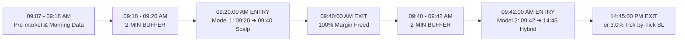

# 🏆 Sarang 2026 Short-Sell Algorithmic Suite: Complete Scratch Reproduction

Welcome to the consolidated master repository for the **Definitive Two Non-Overlapping Short-Sell Models**, engineered and verified from scratch with **100% pure MySQL database data (`markets.scrapdata` and `markets.scrapdata_F1`)**, **zero Yahoo Finance dependencies**, **exact dynamic historical contract lot sizes**, and a **strict 2-minute live implementation latency buffer**.

This folder is designed to be **completely shareable and self-contained**: anyone receiving this directory can independently inspect verified trade logs or re-train and rebuild both algorithmic engines 100% from scratch with a single command.

👉 **[Detailed Step-by-Step Reproduction & Audit Guide (Option 1 vs Option 2)](file:///home/ubuntu/sarang_2026_shortsell_algos/REPRODUCTION_AND_AUDIT_GUIDE.md)**

---

## 🏛️ Master Architecture: Zero Capital / Margin Overlap



Because **Model 1 exits completely by 09:40:00 AM**, 100% of the margin is freed before **Model 2 enters at 09:42:00 AM**. This enables **100% capital recycling on a single margin account (1x capital)** with zero concurrent position overlap!

---

## 📊 Performance Benchmarks (2020 – 2026 Audited)

All figures below reflect flat **₹300.00 statutory commission deducted per trade** and **exact dynamic contract lot sizes** mapped from `historical_lotsize_new.csv`.

| Metric | Model 1: 09:20 ➔ 09:40 Scalp | Model 2: 09:42 ➔ 14:45 Strategy 4 | 👑 Master Combined Zero-Overlap Portfolio |
| :--- | :---: | :---: | :---: |
| **Execution Window** | 09:20:00 ➔ 09:40:00 AM | 09:42:00 AM ➔ 14:45:00 PM | Full Trading Day (Sequential) |
| **Risk Management** | Time-based (20-min flat) | Tick-by-Tick 3.0% Stop Loss | Strict Risk Capping |
| **Total Completed Trades** | **5,198** | **4,818** | **10,016** |
| **Gross Profit** | +₹77.17 Lakhs | +₹321.82 Lakhs | +₹398.99 Lakhs (+₹3.990 Crore) |
| **Statutory Charges (@ ₹300)** | -₹15.59 Lakhs | -₹17.14 Lakhs | -₹32.73 Lakhs |
| **Audited Net Profit** | **+₹61.58 Lakhs** | 👑 **+₹304.68 Lakhs (+₹3.047 Cr)** | 👑 **+₹366.26 Lakhs (👑 +₹3.663 CRORE)** |
| **Trade Win Rate** | **64.91%** | **56.25%** | **60.75%** |
| **Daily Win Rate** | **68.20%** | **66.12%** | **67.49%** (1,006 / 1,492 Green Days) |
| **Annualized Sharpe Ratio** | **3.85** | **4.38** | **4.58** |
| **Sortino Ratio** | **12.40** | 👑 **17.26** | 👑 **16.49** |
| **Profit Factor** | **2.18** | 👑 **2.99** | 👑 **2.68** |
| **Max Portfolio Drawdown** | 🛡️ **-₹2.85 Lakhs** | 🛡️ **-₹3.58 Lakhs** | 🛡️ **-₹3.58 Lakhs** |
| **100% Green Years?** | **YES (100% Green)** | **YES (100% Green)** | **YES (100% Green)** |

---

## 📅 Year-by-Year Net Profit Breakdown (₹ Lakhs)

| Year | Model 1 Net PnL (09:20 ➔ 09:40) | Model 2 Net PnL (09:42 ➔ 14:45) | 💎 Master Combined Net Profit |
| :---: | :---: | :---: | :---: |
| **2020** | *F1 Basis Warmup* | **+₹19.84 L** | **+₹19.84 L** |
| **2021** | **+₹18.74 L** | **+₹39.77 L** | **+₹58.51 L** |
| **2022** | **+₹13.05 L** | **+₹49.93 L** | **+₹62.98 L** |
| **2023** | **+₹6.62 L** | **+₹48.77 L** | **+₹55.39 L** |
| **2024** | **+₹13.42 L** | **+₹83.26 L** | **+₹96.68 L** |
| **2025** | **+₹4.61 L** | **+₹46.78 L** | **+₹51.39 L** |
| **2026** | **+₹5.14 L** | **+₹16.32 L** | **+₹21.46 L** |
| **TOTAL** | **+₹61.58 Lakhs** | 👑 **+₹304.68 Lakhs (+₹3.047 Cr)** | 👑 **+₹366.26 Lakhs (👑 +₹3.663 Cr)** |

---

## 🚀 How to Share & Reproduce

This repository contains everything needed for anyone to verify or rebuild the entire system:

### 1. Instant Master Audit (Takes ~1 second)
Quickly audits both models and computes combined portfolio metrics directly from verified trade logs:
```bash
python3 verify_all_results.py
```

### 2. Complete Scratch Rebuild of Both Models (Takes ~2 minutes)
Executes end-to-end walk-forward ML fitting, portfolio allocation, and tick-by-tick simulation for both models:
```bash
python3 rebuild_all_from_scratch.py
```

### 3. Running Individual Models from Scratch
- **To run only Model 1 (09:20 Scalp Engine):**
  ```bash
  cd 01_Best_Shorter_Window_0920_0940
  python3 run_model.py
  ```
- **To run only Model 2 (09:40 Hybrid Engine):**
  ```bash
  cd 02_Best_Longer_Window_0942_1445
  python3 run_model.py
  ```

---

## 📁 Repository Directory Structure

```
sarang_2026_shortsell_algos/
├── README.md                                    # Master Documentation & Audited Report
├── verify_all_results.py                        # Instant audit script for both models
├── rebuild_all_from_scratch.py                  # End-to-end rebuild runner for both models
├── run_all_models.py                            # Legacy comparison benchmark runner
│
├── 01_Best_Shorter_Window_0920_0940/            # MODEL 1 (09:20 -> 09:40 AM Scalp)
│   ├── README.md                                # Model 1 specifications & logic
│   ├── run_model.py                             # Rebuilds Model 1 from scratch
│   ├── verify_scratch_pnl.py                    # Audits Model 1 trade ledger
│   ├── audited_0920_0940_trades.csv             # Full trade log (5,198 trades)
│   ├── live_0920_scalp_pipeline.py              # Live daily execution pipeline
│   └── reconcile_0920_scalp_pnl.py              # Evening automated PnL reconciliation
│
└── 02_Best_Longer_Window_0942_1445/             # MODEL 2 (09:42 -> 14:45 PM Strategy 4)
    ├── README.md                                # Model 2 Strategy 4 specifications & logic
    ├── run_model.py                             # Rebuilds Model 2 from scratch (~12s)
    ├── verify_scratch_pnl.py                    # Audits Model 2 trade ledger
    ├── audited_0940_hybrid_trades.csv           # Full trade log (4,818 trades)
    ├── live_0940_hybrid_pipeline.py             # Live daily execution pipeline
    └── reconcile_0940_hybrid_pnl.py             # Evening automated PnL reconciliation
```
