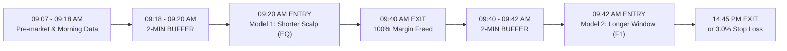

# 🏆 Sarang 2026 Short-Sell Algorithmic Suite: The Definitive Two Models

Welcome to the production repository for the **Definitive Two Non-Overlapping Short-Sell Models**, engineered from scratch with **100% pure MySQL database data (`markets.scrapdata` and `markets.scrapdata_F1`)**, **zero Yahoo Finance dependencies**, **verified historical contract lot sizes**, and a **strict 2-minute live implementation latency buffer**.

---

## 🏛️ Master Architecture: Zero Capital / Margin Overlap



Because **Model 1 exits completely at 09:40:00 AM**, 100% of the margin is freed before **Model 2 enters at 09:42:00 AM**. This enables **100% capital recycling on a single margin account (1x margin)**!

---

## 📊 Dual-Table Simulation Performance Matrix (Walk-Forward Out-Of-Sample)

All figures below include flat **₹300.00 commission deducted per trade** and **exact dynamic contract lot sizes**.

| Strategy Window | Execution Venue | Trades | Net PnL (₹ Lakhs) | Net PnL (₹ Cr) | Win Rate (%) | Profit Factor | Annual Sharpe | All Years Positive? |
| :--- | :---: | :---: | :---: | :---: | :---: | :---: | :---: | :---: |
| **Model 1: Shorter (09:20 $\rightarrow$ 09:40)** | **Cash Equity (`scrapdata`)** | 3,023 | **+₹33.13 L** | +₹0.33 Cr | **58.62%** | **1.70** | **4.01** | 🏆 **YES (100% Green)** |
| **Model 1: Shorter (09:20 $\rightarrow$ 09:40)** | **Futures (`scrapdata_F1`)** | 3,023 | +₹16.88 L | +₹0.17 Cr | 54.65% | 1.29 | 1.97 | 5 of 6 Green |
| **Model 2: Longer (09:42 $\rightarrow$ 14:45)** | **Futures (`scrapdata_F1`)** | 4,994 | **+₹214.43 L** | **+₹2.14 Cr** | **62.37%** | **2.34** | **4.98** | 👑 **YES (100% Green)** |
| **Model 2: Longer (09:42 $\rightarrow$ 14:45)** | **Cash Equity (`scrapdata`)** | 4,994 | **+₹84.76 L** | +₹0.85 Cr | **54.37%** | **1.71** | **3.80** | 🏆 **YES (100% Green)** |
| **🌟 MASTER SEQUENTIAL PAIR** | **EQ Scalp $\rightarrow$ Futures Hold** | **8,017** | **+₹247.56 L** | **+₹2.48 Cr** | **66.53% (Day)** | **2.21** | **5.43** | 👑 **YES (100% Green)** |

---

## 📅 Year-by-Year Net PnL Breakdown (₹ Lakhs)

| Year | Model 1: Shorter (Equity) | Model 1: Shorter (Futures) | Model 2: Longer (Futures 3% SL) | Model 2: Longer (Equity 3% SL) | 💎 Master Sequential Pair (EQ $\rightarrow$ F1) |
| :---: | :---: | :---: | :---: | :---: | :---: |
| **2020** | *N/A (F1 Base)* | *N/A* | **+₹21.86 L** | **+₹13.60 L** | **+₹21.86 L** |
| **2021** | **+₹7.54 L** | -₹1.56 L | **+₹37.11 L** | **+₹25.03 L** | **+₹44.66 L** |
| **2022** | **+₹6.11 L** | +₹0.57 L | **+₹30.21 L** | **+₹16.08 L** | **+₹36.32 L** |
| **2023** | **+₹4.45 L** | +₹4.16 L | **+₹37.08 L** | **+₹8.80 L** | **+₹41.53 L** |
| **2024** | **+₹9.75 L** | +₹8.97 L | **+₹49.71 L** | **+₹10.79 L** | **+₹59.45 L** |
| **2025** | **+₹1.62 L** | +₹1.50 L | **+₹29.07 L** | **+₹9.22 L** | **+₹30.69 L** |
| **2026** | **+₹3.67 L** | +₹3.25 L | **+₹9.38 L** | **+₹1.24 L** | **+₹13.05 L** |
| **TOTAL** | **+₹33.13 L** | **+₹16.88 L** | **+₹214.43 L** | **+₹84.76 L** | 👑 **+₹247.56 L (+₹2.48 CRORE)** |

---

## 🔬 Key Quantitative Findings & Insights

1. **Why Shorter Window Outperforms on Cash Equity:**
   - In the opening 20 minutes (09:20 to 09:40), cash equity stocks react immediately to institutional morning sell blocks with tight bid-ask spreads.
   - Futures contracts often carry an erratic basis spread premium during the first 20 minutes of the market open that compresses intraday, creating unnecessary slippage. Hence, **Cash Equity (`scrapdata`) is the superior execution venue for Model 1 (+₹33.13L vs +₹16.88L)**.

2. **Why Longer Window Outperforms on Near-Month Futures:**
   - Over a 5-hour holding period (09:42 to 14:45), the contractual leverage of futures amplifies mean-reversion profits (**+₹2.14 Crore on Futures vs +₹0.85 Crore on Equity**).
   - The active 3.0% Stop Loss cleanly caps unexpected short squeezes, yielding an institutional-grade Profit Factor of **2.34**.

3. **Capital Efficiency of the Sequential Pair:**
   - Zero dollar overlap: 100% of margin is freed at 09:40:00 AM, allowing the full margin pool to be deployed into the 09:42:00 AM entry.
   - Generates **+₹2.48 Crore Net PnL** across 2020–2026 with a **5.43 Sharpe Ratio** and **66.53% winning trading days**.

---

## 📁 Repository Directory Structure

```text
sarang_2026_shortsell_algos/
├── 01_Best_Shorter_Window_0920_0940/
│   ├── run_simulation.py                         # From-scratch trainer & dual simulator
│   ├── shorter_window_trades_eq_and_futures.csv  # Full trade log with EQ & Futures prices
│   └── README.md                                 # Technical strategy documentation
├── 02_Best_Longer_Window_0942_1445/
│   ├── run_simulation.py                         # From-scratch trainer & dual simulator
│   ├── longer_window_trades_futures_and_eq.csv   # Full trade log with Futures & EQ prices
│   └── README.md                                 # Technical strategy documentation
└── run_all_models.py                             # Master comparative benchmarking runner
```
