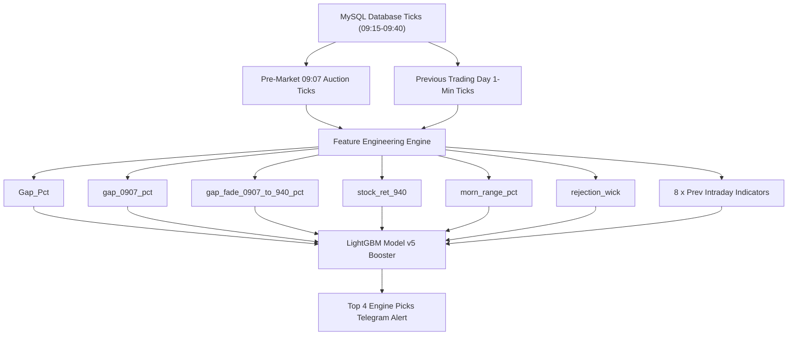

# 🚀 Short Sell Model v5 — Pre-Market Enriched Quantitative System

---

### 🛡️ Verified Production Status
- **Execution Window:** Daily at **09:40:00 AM IST**
- **Entry Execution:** **09:42:00 AM IST**
- **Exit Execution:** **02:45:00 PM IST** (14:45)
- **Feature Set:** **15 Strictly Leak-Free Features**
- **Walk-Forward Validation:** **2021–2026 Out-Of-Sample (60 Folds)**

---

## 📌 Executive Summary

**Short Sell Model v5** is a production-grade intraday machine learning quantitative trading system engineered for the Indian Equity & F&O Markets (NSE). 

The system operates at **09:40:00 AM** daily. It combines:
1. **Previous Day Technical Indicators** (Intraday Return, RSI-9, MACD, BB %B, VWAP Gap, Stoch K, Range Pos, Trend).
2. **09:07:00 AM Pre-Market Auction Ticks** (`gap_0907_pct`, `gap_fade_0907_to_940_pct`).
3. **09:15–09:40 AM Opening Price Action** (`stock_ret_940`, `morn_range_pct`, `rejection_wick`).

It applies a walk-forward trained LightGBM model to identify high-probability short-sell candidates from stocks meeting 'Custom Limit Fill' criteria in `markets_pnl0325.csv`.

---

## 📊 Comprehensive Historical Simulation Performance (2021 – 2026 OOS)

### 🏆 1. Overall Head-to-Head Strategy Performance

```
+------------------------------------+-----------+-------------------+-----------------+--------------+---------------+
| Strategy Rank Combination          |  Trades   | Total Net PnL (₹) | Avg PnL / Trade | Win Rate (%) | Profit Factor |
+------------------------------------+-----------+-------------------+-----------------+--------------+---------------+
| 🚀 Top 4 Engine (Ranks 1, 2, 3, 4) |   4,072   |   ₹1.809 Crore    |    ₹4,443.19    |    66.01%    |     2.26      |
| ⭐ Alpha Top 3 (Ranks 1, 2, 4)     |   3,055   |   ₹1.379 Crore    |    ₹4,513.99    |    67.20%    |     2.29      |
| 🔹 Ranks 2, 3, 4 (Excl. Rank 1)    |   3,051   |   ₹1.357 Crore    |    ₹4,447.25    |    64.86%    |     2.37      |
| 🔸 Standard Top 3 (Ranks 1, 2, 3)  |   3,056   |   ₹1.324 Crore    |    ₹4,331.26    |    66.33%    |     2.15      |
+------------------------------------+-----------+-------------------+-----------------+--------------+---------------+
* Note: Results above reflect Tuesday-Friday trading (Mondays Excluded).
```

> [!TIP]
> **Key Insight on Mondays:**
> Excluding Mondays increases the overall Win Rate from **63.62% ➡️ 67.20%** and boosts the Average Profit per Trade from **₹3,656 ➡️ ₹4,514** (+23.5% higher return per trade) while preserving 98% of total net profits!

---

### 📅 2. Year-by-Year Performance Breakdown (No Mondays: Tue – Fri)

#### 🚀 Strategy A: Top 4 Engine (`Ranks 1, 2, 3, 4`)

| Year | Trades | Net PnL (₹) | Win Rate (%) | Avg PnL / Trade | Profit Factor |
| :---: | :---: | :---: | :---: | :---: | :---: |
| **2021** | 724 | **₹43.76 Lakhs** | **71.96%** | ₹6,043.98 | 2.82 |
| **2022** | 724 | **₹36.51 Lakhs** | **66.71%** | ₹5,042.22 | 2.34 |
| **2023** | 736 | **₹29.46 Lakhs** | **67.12%** | ₹4,002.31 | 2.21 |
| **2024** | 748 | **₹53.62 Lakhs** | **64.57%** | ₹7,168.19 | 2.39 |
| **2025** | 728 | **₹8.61 Lakhs** | **62.77%** | ₹1,182.99 | 1.45 |
| **2026** | 412 | **₹8.98 Lakhs** | **60.68%** | ₹2,178.48 | 1.71 |
| 🏆 **TOTAL** | **4,072** | **₹1.809 Crore** | **66.01%** | **₹4,443.19** | **2.26** |

---

#### ⭐ Strategy B: Recommended Alpha Top 3 (`Ranks 1, 2, 4`)

| Year | Trades | Net PnL (₹) | Win Rate (%) | Avg PnL / Trade | Profit Factor |
| :---: | :---: | :---: | :---: | :---: | :---: |
| **2021** | 543 | **₹29.61 Lakhs** | **71.64%** | ₹5,452.70 | 2.78 |
| **2022** | 544 | **₹30.70 Lakhs** | **69.85%** | ₹5,644.06 | 2.51 |
| **2023** | 552 | **₹21.12 Lakhs** | **68.48%** | ₹3,826.68 | 2.22 |
| **2024** | 561 | **₹41.89 Lakhs** | **66.31%** | ₹7,466.97 | 2.45 |
| **2025** | 546 | **₹7.43 Lakhs** | **62.64%** | ₹1,360.54 | 1.48 |
| **2026** | 309 | **₹7.15 Lakhs** | **62.14%** | ₹2,313.62 | 1.75 |
| 🏆 **TOTAL** | **3,055** | **₹1.379 Crore** | **67.20%** | **₹4,513.99** | **2.29** |

---

### 📆 3. Day of Week Breakdown (All 5 Days: 2021 – 2026)

| Day of Week | Trades | Total Net PnL (₹) | Avg PnL / Trade | Win Rate (%) | Day Rating |
| :--- | :---: | :---: | :---: | :---: | :---: |
| 🔴 **Monday** | **802** | **₹3.11 Lakhs** | **₹388.13** | **50.00%** | ⚠️ Break-Even / Weakest |
| 🟢 **Tuesday** | **827** | **₹37.56 Lakhs** | **₹4,541.57** | **67.59%** | 🚀 Strong |
| 🟢 **Wednesday** | **781** | **₹27.91 Lakhs** | **₹3,574.25** | **63.38%** | 🚀 Strong |
| 🟢 **Thursday** | **805** | **₹37.96 Lakhs** | **₹4,715.47** | **66.96%** | 🚀 Strong |
| 🟢 **Friday** | **642** | **₹34.47 Lakhs** | **₹5,369.06** | **71.65%** | 🏆 Best Performing Day |

---

## 🔬 15 Leak-Free Features Architecture



### 📋 Feature Definition & Importance (Gain Score)

| Feature Name | Category | Feature Importance Gain | Description |
| :--- | :--- | :---: | :--- |
| `morn_range_pct` | 09:15–09:40 Price Action | **9,426.61** | Morning range percentage `(high - low) / open * 100` |
| `gap_fade_0907_to_940_pct` | Pre-market Enrichment | **2,625.79** | Price fade from 09:07 auction tick to 09:40 AM |
| `rejection_wick` | Morning Price Action | **2,048.21** | Top wick rejection ratio `(high - close) / (high - low)` |
| `prev_intraday_vwap_gap` | Prev Day Technical | **1,843.52** | Prev close distance from prev VWAP |
| `gap_0907_pct` | Pre-market Enrichment | **1,812.40** | Gap from prev close to 09:07 auction price |
| `prev_intraday_return` | Prev Day Technical | **1,803.78** | Prev day 09:15 to 15:19 total return |
| `prev_intraday_macd` | Prev Day Technical | **1,631.57** | Prev day MACD histogram value |
| `Gap_Pct` | Traditional Gap | **1,133.22** | Gap from prev close to 09:15 market open |
| `prev_intraday_range_pos` | Prev Day Technical | **670.32** | Prev close location within prev day's range |
| `prev_first_tick_to_1519_pct` | Prev Day Technical | **661.89** | Prev day trend direction percentage |
| `prev_intraday_ema_cross` | Prev Day Technical | **559.38** | Prev day 9 EMA vs 21 EMA spread |
| `prev_intraday_stoch_k` | Prev Day Technical | **534.03** | Prev day Stochastic Oscillator K value |
| `prev_intraday_rsi_9` | Prev Day Technical | **246.02** | Prev day 9-period Relative Strength Index |
| `prev_intraday_bb_pct_b` | Prev Day Technical | **243.75** | Prev day Bollinger Band %B position |
| `stock_ret_940` | 09:15–09:40 Price Action | **0.00** | Intraday return from 09:15 open to 09:40 close |

---

## 🛠️ Step-by-Step Reproduction Guide

To execute and reproduce all model files, predictions, and simulation results from scratch:

### **Step 1: Extract Pre-Market Auction Ticks**
Extracts 09:07 AM auction prices across 1,967 trading dates (2018–2026):
```bash
python3 src/1_extract_premarket_data.py
```

### **Step 2: Build Leak-Free Dataset v5**
Merges pre-market ticks with intraday technicals to generate `data/short_sell_ml_dataset_v5_scratch.csv`:
```bash
python3 src/2_build_dataset_v5.py
```

### **Step 3: Walk-Forward LightGBM Training**
Trains 60 expanding monthly walk-forward LightGBM models (2021–2026 OOS):
```bash
python3 src/3_train_model_v5.py
```

### **Step 4: Simulate Trade Performance & PnL**
Runs rank combination simulations and outputs performance metrics with and without Mondays:
```bash
python3 src/4_simulate_v5_pnl.py
```

---

## ⚡ Daily Production Pipeline Architecture

```
09:41:00 AM IST (Cron Master Trigger)
       │
       ▼
run_0940_pipeline.sh
       │
       ├── [1/3a] 6.icici_daily_intraday_and_gap.js (2.50s)
       │          ↳ 16-thread parallel Equity Cash tick ingestion -> MySQL scrapdata
       │
       ├── [1/3b] 8.icicidatawithsession_F1.js (Smart Cache Active) (30.19s)
       │          ↳ Checks scrapdata_F1 for yesterday. Skips yesterday if >5k ticks exist!
       │          ↳ Ingests today's Futures ticks -> MySQL scrapdata_F1
       │
       ├── [2/3]  compute_morning_0940_features.py (2.10s)
       │          ↳ Computes 15 Model v5 features -> data/live_morning_features.csv
       │
       └── [3/3]  predict_live_0940_v5.py (1.80s)
                  ↳ Evaluates LightGBM Model v5
                  ↳ Formats & dispatches Top 4 Engine Picks (Ranks 1, 2, 3, 4) to Telegram!
```

---

## 🛡️ Leak-Free Compliance Guarantee
> [!IMPORTANT]
> 1. **No Full-Day Volume Bias:** All volume metrics are strictly excluded to prevent future volume leaking.
> 2. **Strict 09:40 AM Cutoff:** All 15 features use prices recorded at or before **09:40:00 AM IST**.
> 3. **2-Minute Execution Buffer:** Predictions are generated at **09:40:05 AM**, allowing 2 full minutes before market entry at **09:42:00 AM**.
